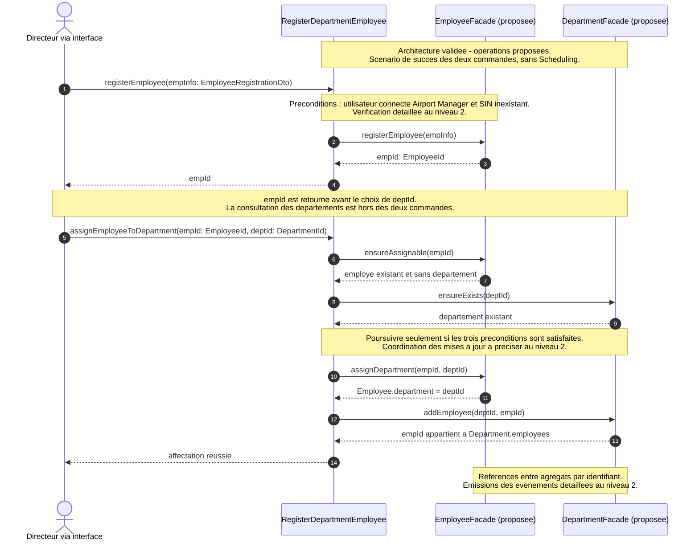
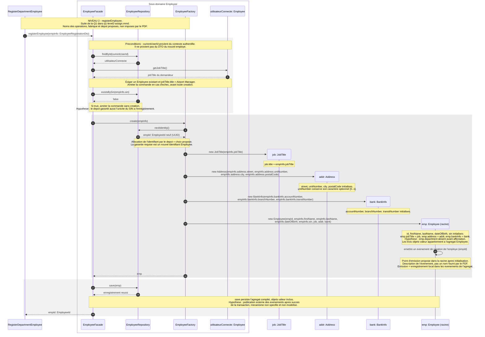
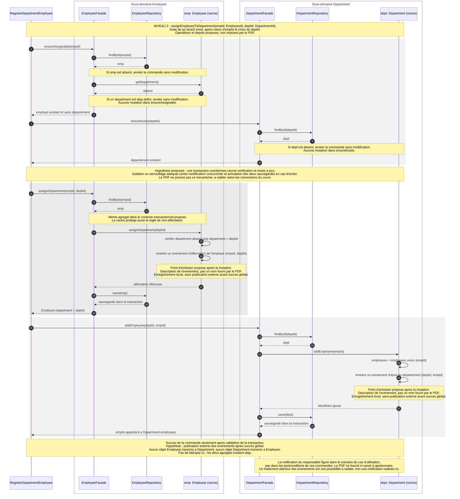

# SEG3502 — Devoir 2 : diagrammes UML

Diagrammes de séquence du cas d’utilisation **RegisterDepartmentEmployee**.

Les diagrammes sont affichés ci-dessous. Les fichiers `.mmd` restent disponibles pour modification dans Mermaid Live ou un autre éditeur compatible.

Propositions de travail : les hypothèses de conception figurent dans les notes des diagrammes.

## Sommaire

- [Question 1 — Niveau 1](q1-level1.mmd)

- [Question 1 — Niveau 2 : registerEmployee](q1-level2.mmd)

- [Question 1 — Niveau 2 : assignEmployeeToDepartment](q1-level2-assign.mmd)

## Question 1 — Niveau 1

[Source Mermaid](q1-level1.mmd)

## Question 1 — Niveau 2 : registerEmployee

[Source Mermaid](q1-level2.mmd)

## Question 1 — Niveau 2 : assignEmployeeToDepartment

[Source Mermaid](q1-level2-assign.mmd)

